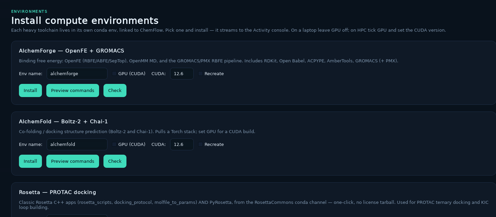

# Installing ChemFlow

ChemFlow requires Python 3.11. The supported installation uses Miniforge (or
another Conda-compatible distribution) and Mamba.

**Install ChemFlow first.** ChemFlow is the base (machine-learning) environment and
the entry point for everything else. Once it is installed you use ChemFlow itself —
either the desktop **Environments** page or the `chemflow …-env install` commands — to
build the heavier compute environments (AlchemForge, AlchemFold, Rosetta). Those live
in separate conda environments because their simulation and ML dependency stacks have
different constraints.

The order is:

1. [Prerequisites](#prerequisites) and [Download ChemFlow](#download-chemflow).
2. Install the ChemFlow environment —
   [local / CPU / Apple Silicon](#local-cpu-and-apple-silicon-installation) or
   [NVIDIA GPU / HPC](#nvidia-gpu-installation-on-linux-or-hpc).
3. [Install the compute environments with ChemFlow](#install-the-compute-environments-with-chemflow)
   (AlchemForge / AlchemFold / Rosetta).

## Prerequisites

Install these before creating the environment:

- Git
- Miniforge, Mambaforge, or another Conda-compatible installation
- Mamba (recommended) or Conda
- On an HPC system, access to a supported NVIDIA driver and GPU compute node

If Conda is installed but Mamba is not, install Mamba into the base
environment:

```bash
conda install --name base --channel conda-forge mamba
```

Verify the environment manager:

```bash
conda info --base
mamba --version
```

## Download ChemFlow

```bash
git clone https://github.com/yonglanliu/ChemFlow.git
cd ChemFlow
```

Run all environment creation and update commands from the repository root.
The requirements files contain the editable ChemFlow installation, so a
separate `pip install -e .` command is normally unnecessary.

## Local, CPU, and Apple Silicon installation

Create the local environment:

```bash
mamba env create --file env/environment.yaml
mamba activate chemflow
```

The local specification installs the compiled scientific stack with Conda and
the remaining Python packages with pip.

Verify the installation:

```bash
python --version
command -v python
chemflow --help
python -c "import torch, chemprop, lightgbm; print('PyTorch:', torch.__version__)"
python -m pip check
```

Python should report version 3.11, and the Python executable should belong to
the active `chemflow` environment.

## NVIDIA GPU installation on Linux or HPC

The GPU environment installs PyTorch built for CUDA 12.6. The NVIDIA kernel
driver is supplied by the operating system or cluster and must not be replaced
inside the Conda environment.

If the cluster requires a CUDA module, load the module recommended by its
documentation. The exact module name is site-specific:

```bash
module avail cuda
module load cuda/12.6
```

Create and activate the environment:

```bash
mamba env create --file env/environment-hpc.yaml
mamba activate chemflow
```

`descriptastorus` is intentionally installed from PyPI because it is not
provided by the configured Conda channels. PyTorch and Torchvision are
installed from the CUDA 12.6 PyTorch wheel index defined in
`env/requirements-hpc-torch.txt`.

Confirm the installation on the login node:

```bash
python --version
command -v python
python -c "import torch; print(torch.__version__, torch.version.cuda)"
python -m pip check
```

Test CUDA only after obtaining a GPU allocation. For a Slurm cluster, a common
interactive request is:

```bash
srun \
  --partition=gpu \
  --gres=gpu:1 \
  --cpus-per-task=4 \
  --mem=8G \
  --time=00:10:00 \
  --pty bash
```

Partition and resource names vary between clusters. Inside the allocation,
activate ChemFlow and run its real CUDA calculation:

```bash
mamba activate chemflow
nvidia-smi
chemflow gpu-test
```

A successful test ends with:

```text
CHEMFLOW GPU TEST: PASSED
```

Select another visible GPU or increase the diagnostic workload with:

```bash
chemflow gpu-test --device 1
chemflow gpu-test --matrix-size 2048 --iterations 5
```

## Install the compute environments with ChemFlow

With the base **ChemFlow** environment installed and activated, use ChemFlow to build
the heavier compute environments. Each lives in its own conda env and is linked back
to ChemFlow.

### From the desktop (recommended)

Launch the app and open the **Environments** page (*Install compute environments*).
Each card installs one toolchain into its own conda env, links it to ChemFlow, and
streams the log to the Activity console.

```bash
chemflow-desktop
```

<p align="center">
  
</p>

- **AlchemForge — OpenFE + GROMACS** — binding free energy (OpenFE RBFE/ABFE/SepTop),
  OpenMM MD, and the GROMACS/PMX RBFE pipeline (RDKit, Open Babel, ACPYPE, AmberTools,
  GROMACS + PMX).
- **AlchemFold — Boltz-2 + Chai-1** — co-folding / docking structure prediction
  (pulls a Torch stack).
- **Rosetta — PROTAC docking** — classic Rosetta C++ apps and PyRosetta from the
  RosettaCommons conda channel (no license tarball).

For each card: set **Env name** (defaults shown); on a laptop leave **GPU (CUDA)** off,
and on an NVIDIA HPC/workstation tick **GPU (CUDA)** and set the **CUDA** version to
match the GPU partition's driver (not the login node — see
[Installing a CUDA environment from a CPU-only (login) node](#installing-a-cuda-environment-from-a-cpu-only-login-node)).
Use **Preview commands** to see what will run, **Install** to build it, **Check** to
validate an existing env, and **Recreate** to rebuild it from scratch.

### From the command line

The desktop buttons call these same commands — run them yourself if you prefer:

```bash
chemflow fe-env install                 # AlchemForge (OpenFE + GROMACS/PMX)
chemflow boltz-env install              # Boltz-2 co-folding / docking (+ GPU kernels)
chemflow chai-env install               # Chai-1 co-folding / docking
chemflow diffdock-env install           # DiffDock-L blind docking (+ its repo)
chemflow rosetta-env install            # Rosetta + PyRosetta

# add --cuda <ver> for a GPU build, e.g.:
chemflow fe-env install --cuda 12.6 --staged
```

**One env per docking engine.** Boltz-2, Chai-1 and DiffDock-L each get their
own environment because their PyTorch requirements conflict — Chai-1 pins
torch<2.7, while Boltz-2's cuEquivariance kernels need a newer one. AlchemFold,
which writes each engine's input and collects its results, runs from the
`chemflow` env and resolves the engine executable from the engine's own env, so
you never have to activate them. The older shared `chemflow alchemfold-env` is
**deprecated**; it still works for existing setups but should not be used for a
new install.

After installing Boltz-2, `chemflow boltz-env status` prints the path to put in
a docking config (or just leave it — the sibling env named `boltz` is found
automatically):

```yaml
boltz_command: "/path/to/conda/envs/boltz/bin/boltz"
no_kernels: false
```

Add `--dry-run` to print the commands without running them, and use the `status`
subcommand (e.g. `chemflow fe-env status`) to check whether an env is present. See
`src/alchemforge/README.md` and `tutorials/HPC_GUIDE.md` for details.

### Manual environment creation (advanced)

You can also create an environment directly from its yaml spec — for example
AlchemForge:

```bash
mamba env create -f env/environment-alchemforge.yaml            # workstation
# or, on an NVIDIA GPU cluster:
conda env create -n alchemforge -f env/environment-alchemforge-hpc.yaml
mamba activate alchemforge
python -m pip install -e . --no-deps --no-build-isolation   # link ChemFlow (editable)
python -m pip install ./pmx --no-deps --no-build-isolation  # PMX
```

`scripts/dev_install.sh` performs the linking steps for an existing `alchemforge` env.
The AlchemFold and Rosetta specs are `env/environment-alchemfold.yaml` and
`env/environment-rosetta.yaml` (with `-hpc` variants where provided).

## Installing a CUDA environment from a CPU-only (login) node

You do **not** need a GPU to *install* a CUDA environment (the `alchemforge`
free-energy env, or a GPU `chemflow` env). Installing and running the GPU build are
separate steps: the solve only needs conda to be told a CUDA driver exists, and the
actual GPU is required only when you run the code.

The installer handles this for you — `--cuda` sets `CONDA_OVERRIDE_CUDA`, so the GPU
builds of OpenMM and GROMACS resolve and download on a GPU-less login node:

```bash
chemflow fe-env install --cuda 12.6 --staged
```

If you create the environment straight from the yaml instead, export the same
override yourself (there is no GPU for conda to detect):

```bash
CONDA_OVERRIDE_CUDA=12.6 conda env create -n alchemforge -f env/environment-alchemforge-hpc.yaml
```

Two things to keep in mind on a CPU login node:

- **Pin the CUDA version to the GPU partition's driver, not the login node.**
  `nvidia-smi` usually is not available on a CPU node, so you cannot read the ceiling
  locally. Use the value your cluster's GPU nodes report (run `nvidia-smi` once in a
  GPU allocation, or check the cluster docs). Choosing a CUDA newer than the GPU
  driver supports gives OpenMM `CUDA_ERROR_UNSUPPORTED_PTX_VERSION` at run time.
- **Testing the GPU must happen in a GPU allocation.** `alchemforge gpu-test` fails
  on a CPU node because no device is present. Run it after you get a GPU:

  ```bash
  srun --partition=gpu --gres=gpu:1 --cpus-per-task=4 --mem=16G --time=00:15:00 --pty bash
  conda run -n alchemforge alchemforge gpu-test
  ```

For a genuinely CPU-only machine (no GPU anywhere), simply omit `--cuda` to install
the CPU/OpenCL stack.

## Updating an existing installation

Pull the source changes first:

```bash
git pull --ff-only
```

Update a local or CPU environment:

```bash
mamba env update \
  --name chemflow \
  --file env/environment.yaml \
  --prune
mamba activate chemflow
```

Update an NVIDIA HPC environment:

```bash
mamba env update \
  --name chemflow \
  --file env/environment-hpc.yaml \
  --prune
mamba activate chemflow
```

Then validate the installed dependencies and CLI:

```bash
python -m pip check
chemflow --help
```

## Optional model dependencies

Install optional extras only when required:

```bash
python -m pip install -e '.[chemberta]'
python -m pip install -e '.[hf-graphormer]'
python -m pip install -e '.[kermt]'
python -m pip install -e '.[data-curation]'
```

The environment specifications already include the dependencies used by the
standard bundled workflows. Extras are primarily useful for targeted or
minimal installations.
