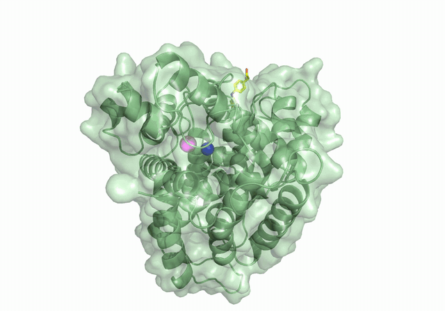

# AlchemFold — Co-Folding (`alchemfold`)

Co-folding predicts the 3D structure of a protein **together with** its ligand
(and, optionally, their binding affinity) in one shot — rather than docking into a
fixed receptor. AlchemFold is a **standalone** component of the platform, separate
from the AlchemForge free-energy package. It supports multiple models behind one
interface: **Boltz-2** and **Chai-1** (sequence-based co-folding) and **DiffDock**
(diffusion docking into a receptor structure).

Two entry points:

- `alchemfold dock …` — **docking with a selectable model** (Boltz-2 / Chai-1) and
  an optional binding-site **pocket** constraint. One config, `engine:` picks the model.
- `alchemfold boltz …` — the Boltz-2-only path (incl. affinity prediction).

The predicted complex (PDB/mmCIF) drops straight into the OpenMM modeling →
free-energy pipeline:

```
alchemfold dock run  →  complex PDB
      │
      ▼
alchemforge openmm modeling build-soluble | build-membrane  →  relax  →  FEP
```

---

## Docking (multi-model) — `alchemfold dock`

```bash
# pick a model with --engine (boltz | chai | diffdock); --pocket adds a binding-site block (not for diffdock)
alchemfold dock generate --engine boltz -o docking.yaml \
    --sequence MKT... --smiles "CC(=O)Oc1ccccc1C(=O)O" --pocket
# edit docking.yaml (sequence, ligand, pocket residues as chain:residue)
alchemfold dock validate docking.yaml
alchemfold dock run docking.yaml            # --dry-run prints the engine command
```

| Model (`engine`) | Package | Notes |
|---|---|---|
| `boltz` (Boltz-2) | `boltz` | MIT, local; supports binding-affinity prediction + pocket constraints |
| `chai` (Chai-1) | `chai-lab` | open weights, local; pocket via a restraints file (best-effort) |
| `diffdock` (DiffDock-L) | **own conda env** + GitHub repo (`chemflow diffdock-env install`) | fast diffusion **docking into a receptor PDB**; blind — no pocket/affinity; gives pose *confidence* only |

**Boltz-2 GPU kernels.** Boltz's triangle kernels (cuEquivariance) speed up — and
shrink the memory of — the triangle attention/multiplicative update that dominates
large complexes. They need a recent PyTorch, which Chai-1's `torch<2.7` pin forbids,
which is why each engine has its own env:

```bash
chemflow boltz-env install --cuda 12.6      # or the Environments page in the desktop app
chemflow chai-env install                   # Chai-1, separate env
chemflow diffdock-env install               # DiffDock-L, separate env + repo

python -m alchemfold dock generate --engine boltz --kernels ...
```

**One env per engine.** AlchemFold itself runs from the `chemflow` env; it resolves
`boltz` / `chai-lab` / DiffDock from the sibling conda env named after the engine,
so nothing needs activating. `--boltz-env NAME` / `--chai-env NAME` name a
differently-titled env (resolved into `boltz_command` / `chai_command`), and
`--boltz-command` / `--chai-command` take an explicit path. For HPC screening,
`slurm.conda_env` is the env that can import AlchemFold — `chemflow` — **not** an
engine env; the shards call each engine by absolute path. The old shared
`alchemfold` env is deprecated.

**Job folder:** pass `--jobname NAME` to `dock generate` and EVERYTHING for the run — the config
(`NAME/docking.yaml`), the engine inputs, `run_docking.slurm`, logs and `predictions/` — goes under
`<workdir>/NAME/`. (`screen`, `gpu-test` and the `diffdock-env` tests follow the same rule.)

The **pocket** block steers the ligand into a known site (Boltz/Chai only; DiffDock
is blind docking):

```yaml
pocket:
  binder: L                 # which ligand binds
  max_distance: 6.0         # Angstrom
  contacts:                 # pocket-lining residues
    - {chain: A, residue: 123}
    - {chain: A, residue: 145}
```

`dock` commands: `generate` (`--engine`, `--pocket`, `--sequence`, `--smiles`,
`--protein-id`, `--ligand-id`, `-o`, `--force`), `validate`, `stage`,
`run [--dry-run]`. The desktop equivalent is **AlchemFold → Docking**, whose
**Model** dropdown selects the engine.

You can also dock from a **ligand file** instead of a single SMILES — a CSV
(`smiles` column, optional `name`), a `.smi`, or a `.cxsmiles` file (plain or
`.bz2`/`.gz`). A single-file list is docked one run per entry:

```yaml
ligand_file: "ligands.smi"
ligand_file_format: "auto"     # auto | csv | smiles | cxsmiles
```

---

## Virtual screening (`alchemfold screen`)

Screen a ligand library in parallel on HPC and keep the top hits:

```
combine ligand_files → split into shards → SLURM array (1 task/shard, across
GPUs/nodes) → dock each shard with the chosen engine → rank → top-K
```

```bash
alchemfold screen generate --engine boltz -o screen.yaml   # commented template
# edit screen.yaml: add receptor sequence + ligand_files + sharding + [slurm]
alchemfold screen validate screen.yaml
alchemfold screen stage    screen.yaml                      # writes shards + jobs
bash submit_screen.sh                                       # on the cluster
#   -> sbatch dock_array.sh  (array), then rank.sh (afterok dependency)
alchemfold screen rank     screen.yaml                      # (also run by rank.sh)
```

Config highlights: `ligand_files` (a **list** of libraries), `n_shards` **or**
`shard_size`, a `[slurm]` block (`partition`, `account`, `nodes`,
`gpus_per_task` — `0` for CPU, `gpu_type`, `cpus_per_task`, `mem`, `time`,
`conda_env`), and `[ranking]` (`metric`, `top_k`, `order`, `output`). The array
is emitted as a plain `#SBATCH --array=0-N` (no concurrency cap), so the
scheduler fills every free GPU/node.

Ranking scrapes a score per predicted complex (`auto` picks per engine: Boltz-2
affinity/confidence, Chai aggregate/ptm, DiffDock confidence), writes a sorted
`ranking.csv`, and copies the top-K structures to `top/`. Score parsing is
best-effort across engine versions — check `ranking.csv` and adjust
`ranking.metric` if needed. The desktop equivalent is **AlchemFold → Virtual
Screening**.

---

## Requirements

- **Boltz-2** (`pip install boltz`) with a GPU — needed only to `run`.
- Internet access if `use_msa_server: true` (Boltz computes MSAs on its server);
  otherwise provide a precomputed MSA per chain and set `use_msa_server: false`.

The config / validation / staging layer is import-light (only PyYAML), so you can
`generate`, `validate`, and `stage` without Boltz installed.

---

## Quick start

```bash
# 1. generate a commented config and edit in your sequence + ligand
alchemfold generate -o cofold.yaml --sequence MKT... --smiles "CC(=O)Oc1ccccc1C(=O)O"

# 2. (optional) validate without Boltz
alchemfold boltz validate cofold.yaml

# 3. run Boltz-2 (GPU)
alchemfold boltz run cofold.yaml            # --dry-run prints the boltz command

# 4. feed the predicted complex into system modeling + FEP
alchemforge openmm modeling build-soluble run soluble.yaml
```

`alchemfold generate` flags: `-o/--output`, `--protein-id`, `--ligand-id`,
`--sequence`, `--smiles`, `--no-affinity`, `--force`.

---

## CLI

| Command | Purpose |
|---|---|
| `alchemfold generate` | Write a fully-commented example config YAML |
| `alchemfold boltz validate CONFIG` | Check inputs (no Boltz needed) |
| `alchemfold boltz stage CONFIG` | Write a `run_cofold_boltz.sh` runner |
| `alchemfold boltz run CONFIG [--dry-run]` | Build the Boltz input + run `boltz predict` |

(`python -m alchemfold ...` works too.)

---

## Config

Key fields (see the generated file for inline explanations):

- `proteins`: list of `{id, sequence, [msa]}` chains.
- `ligands`: list of `{id, smiles}` or `{id, ccd}` (PDB chemical-component code).
- `predict_affinity` / `affinity_binder`: enable Boltz-2 affinity for a ligand id.
- `use_msa_server`, `diffusion_samples`, `recycling_steps`, `sampling_steps`,
  `seed`, `accelerator` (gpu/cpu/tpu), `devices`, `output_format` (pdb/mmcif),
  `boltz_command`, `out_dir`, `override`.

Co-folding requires either a **ligand** or **≥ 2 protein chains** — a single apo
chain is plain structure prediction and is rejected.

---

## Layout

One folder per engine — everything only that engine needs lives inside it:

| Path | Role |
|---|---|
| `boltz/` | Boltz-2: `engine.py` (adapter), `run.py` (input YAML + `boltz predict`), `batch.py` (library screening), `config.py` (standalone co-folding config) |
| `chai/` | Chai-1: `engine.py` |
| `diffdock/` | DiffDock-L: `engine.py`, `batch.py`, `traj.py` (trajectory cleanup), `_shim.py` (embeds each receptor once per run) |
| `engines/__init__.py` | registry mapping `engine:` → the three adapters |

Shared across engines, at the top level:

| File | Role |
|---|---|
| `cli.py` / `__main__.py` | the `alchemfold` CLI |
| `dock_config.py` / `dock_run.py` / `dock_batch.py` | docking config, dispatch, per-ligand batching |
| `screen.py` / `screen_config.py` | library screening: shard, submit, rank |
| `hpc_config.py` | SLURM presets (`env/hpc.yaml`) |
| `_config.py` | YAML/namespace helpers used by every config module |
| `_exec.py` | resolves each engine's executable from its own conda env |
| `gpu_test.py` / `_gpuinfo.py` / `_ddp_probe.py` | GPU checks |

---

## Note on accuracy

Co-folding recovers **orthosteric** poses well but is weaker at **allosteric**
sites, large **induced-fit** motions, and **virtual-screening ranking** (often no
better than docking on diverse decoys). Treat AlchemFold as a pose/complex
*generator* that feeds physics-based relaxation + FEP, not as a standalone
affinity ranker.


## DiffDock-L (separate environment)

<p align="center">
  <br>
  <em>DiffDock-L docking a ligand: reverse diffusion moves it from a random start into the pocket
  (shown 8&times; slower; produced with <code>--diffdock-trajectory</code>).</em>
</p>

DiffDock-L is a fast, **structure-based blind docking** model. It is much quicker per ligand than
Boltz-2/Chai-1 co-folding, but it needs a receptor **structure** and gives a pose-quality
**confidence**, not a binding affinity. It runs from its **own conda env** (it needs the
PyTorch-Geometric stack), never inside the `alchemfold` env.

### What DiffDock takes as input

| Input | What to give | Notes |
|---|---|---|
| **Protein** | a 3D receptor structure, **`receptor_pdb`** (`.pdb`) | Required here (DiffDock can also fold a sequence with ESMFold, but that part is not installed). Use a clean, protein-only structure. DiffDock is built for medium-size proteins of 1–2 chains in a conformation close to the bound one (a holo/near-holo crystal structure); expect weaker results on a very different apo structure or a large complex. **Every ligand is docked into this one fixed structure.** |
| **Ligand** | a SMILES string, or any file RDKit reads (`.sdf`, `.mol2`) | In AlchemFold: an inline `smiles`, or a library file (`.smi` / `.csv` / `.cxsmiles`, plain or `.bz2`/`.gz`), or `enamine_real` / `zinc20`. |
| **Pocket / box** | none | Blind docking over the whole protein — a `pocket:` block is **not** accepted. |
| **Settings** | poses per ligand (`diffdock_samples`, default 10), denoising (reverse-diffusion) steps (`diffdock_inference_steps`, default 20 — DiffDock performs 19 of them, the last being noise-free) | The best pose by confidence is kept. Fewer steps = faster, roughly linearly, with a small accuracy cost. AlchemFold passes these through a generated `--config` YAML, because DiffDock's `inference.py` lets the YAML overwrite command-line flags. |
| **Batch size** | `diffdock_batch_size` (default 10) | GPU batch over the poses of **one** ligand. DiffDock docks ligands strictly one after another, so this does **not** speed up a library; it only helps when poses per ligand exceed it (e.g. 40 poses: batch 10 = 4 GPU passes, batch 40 = 1 pass, more GPU memory). |

DiffDock itself reads a CSV with one row per complex (`complex_name, protein_path,
ligand_description, protein_sequence`). **AlchemFold writes this CSV for you** — you only supply the
receptor PDB and the ligand(s).

### Install (own env)

The env is defined in `env/environment-diffdock.yaml` (Python 3.11, torch 2.4 + CUDA 12.1 wheels,
so it runs on A100 / L40 / H200):

```bash
chemflow diffdock-env install                 # env 'diffdock' + git clone gcorso/DiffDock into <ChemFlow>/DiffDock (next to src/)
chemflow diffdock-env install --cuda 11.8     # other CUDA wheels (11.8 | 12.1 | 12.4)
chemflow diffdock-env install --profile repo  # fallback: build from DiffDock's own environment.yml
chemflow diffdock-env warmup                  # ONCE, on a node WITH internet: DiffDock-L models + ESM2 weights + lookup tables
chemflow diffdock-env status                  # env, repo, models, GPU visibility
```

The desktop equivalent is the **DiffDock-L** card on the **Environments** page (folder, CUDA, Install /
Preview / Check / **Warm-up**). The install also links ChemFlow into the env (`pip install -e`, skip with
`--no-link-chemflow`) and records its location in `~/.config/chemflow/diffdock.yaml`; AlchemFold finds the
env and repo automatically (or set `diffdock_python` / `diffdock_dir` in the config, or
`$CHEMFLOW_DIFFDOCK_PYTHON` / `$CHEMFLOW_DIFFDOCK_DIR`, or the `diffdock:` block of `chemflow_tools.yaml`).
Compute nodes are often offline — run **warm-up** on a login/data node first.

### Run

Single docking:

```bash
alchemfold dock generate --engine diffdock --receptor-pdb receptor.pdb \
    --smiles "CC(=O)Oc1ccccc1C(=O)O" --jobname one \
    --diffdock-samples 10 --diffdock-steps 20     # poses per ligand, denoising steps (defaults)
#   -> everything is written to ./one/ : docking.yaml, DiffDock inputs, run_docking.slurm, predictions/
alchemfold dock validate one/docking.yaml
alchemfold dock run one/docking.yaml
```

Library screen on SLURM (everything goes under `<workdir>/<jobname>/`, config included):

```bash
alchemfold screen generate --engine diffdock --receptor-pdb receptor.pdb \
    --library enamine_real --max-ligands 10000 --n-shards 20 --jobname dd_run \
    --diffdock-samples 5 --diffdock-steps 12      # a faster first pass
alchemfold screen validate dd_run/screen.yaml
alchemfold screen stage    dd_run/screen.yaml
bash dd_run/submit_screen.sh                  # array of shards, then the ranking job
```

In the desktop: **AI docking & screening** → engine `diffdock` → pick the **Receptor PDB**. The page
then hides all the Boltz/Chai controls (sequence, pocket, MSA, kernels, affinity, recycles, sampling steps,
model cache), shows **DiffDock poses per ligand** and **Denoising steps**, shows whether DiffDock was found,
locks GPUs per shard to 1, and ranks by `confidence`.

DiffDock uses **1 GPU per shard** (a config asking for more is refused) — parallelize with more shards.
A screen runs **one DiffDock call per shard**, so the model loads once per shard.

### Output

- `poses/<ligand>.sdf` — the top-ranked (rank 1) pose of every ligand, all in one folder
- `results/shard_*.csv` → merged into `ranking.csv`, with `ligand_id, smiles, confidence, pose`
- `confidence` is DiffDock's pose-quality score (higher is better). It is **not** a binding affinity and is
  known to be weak at separating binders from non-binders — treat DiffDock as a fast pose generator and
  **rescore** the top poses (GNINA / Vina / Glide, or Boltz-2 affinity on the best few thousand).
- **Diffusion trajectory (optional):** `--diffdock-trajectory` (or `diffdock_trajectory: true`, or the
  **Save diffusion trajectory** checkbox in the desktop) makes DiffDock also write
  `rank<k>_reverseprocess.pdb` for each pose — a multi-frame PDB with one frame per denoising step, **ligand
  only**. DiffDock's raw file is not viewer-friendly (its hydrogens never move, so every bond to a hydrogen
  stretches ~50 Å across the box, and the frames are out of order), so AlchemFold writes a **cleaned**
  copy: heavy atoms only, in time order (random start → final pose). Single docking keeps the raw file and
  `rank<k>_trajectory.pdb` (cleaned) in `predictions/<complex>/`; in a screen only each ligand's **best**
  pose is kept, cleaned, as `<job>/trajectories/<ligand>.pdb` (listed in the results CSV and
  `ranking.csv`). Repair an existing raw file with `alchemfold trajectory-fix rank1_reverseprocess.pdb`
  (writes `*_clean.pdb`). The ligand starts at a random position, often tens of Å from the pocket — that is
  the diffusion start, not an error. Load the receptor PDB plus the trajectory in PyMOL / VMD / ChimeraX to watch it dock. Each is
  tens of KB, so leave it off for very large screens.
- **Big libraries:** DiffDock embeds the receptor with ESM2 once per ligand row, so one process with
  10,000 ligands does ~10,000 identical embeddings and holds ~19 GB of them (367-residue receptor).
  AlchemFold runs DiffDock through `diffdock/_shim.py`, which embeds each unique sequence once
  (`diffdock_dedupe_esm: false` turns this off). Still prefer `alchemfold screen` (shards of ~500) over
  one huge `dock run`: shards run in parallel on many GPUs and resume per shard.
- With `cleanup: true` (default) the split library and shard work folders are deleted after ranking when every
  ligand finished.

### Test before a big screen (inside a GPU allocation)

```bash
chemflow diffdock-env gpu-test            # (job folder ./diffdock_gpu_test/) GPU visible? torch build matches the GPU? torch_scatter / torch_cluster / e3nn run on it?
chemflow diffdock-env gpu-test --dock     # + dock 4 small molecules into DiffDock's bundled 1a0q receptor, prints s/ligand
chemflow alchemfold gpu-test --diffdock   # tiny screen through AlchemFold: stage -> run -> rank (add --submit to test sbatch)
```

The first check catches a PyTorch / PyG build that has no kernel for your GPU (for example an old CUDA build
on an H200 or L40) before it fails mid-screen. The first real run also builds SO(2)/SO(3) lookup tables
(a few minutes, cached).
