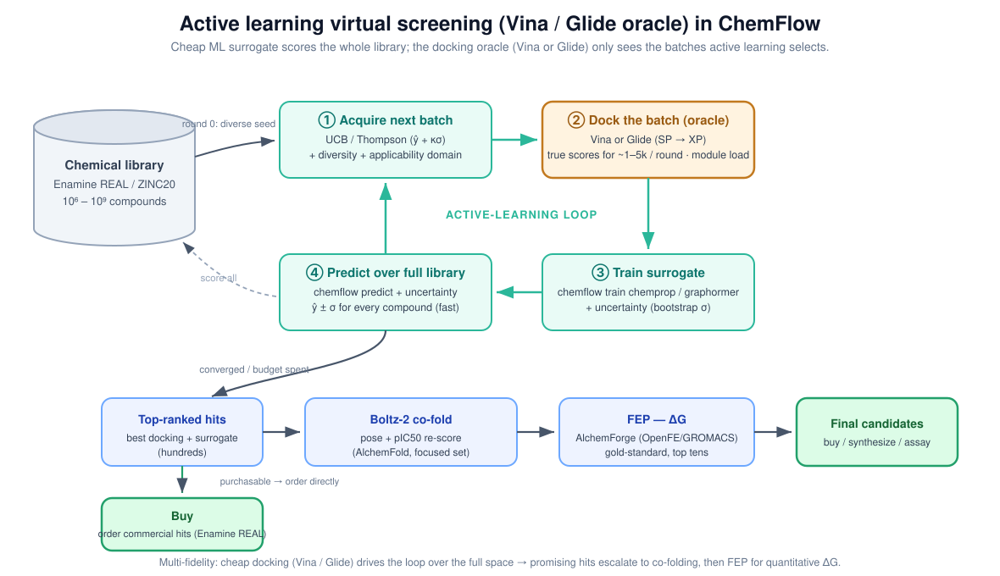

# Active learning virtual screening

Screen an ultra‑large library (e.g. Enamine REAL, 10⁹–10¹⁰ compounds) without
docking all of it. A cheap **Chemprop surrogate** scores the whole library each
round; an expensive **docking oracle** (Schrödinger **VSW**/Glide, or **Vina**)
only docks the small batch that **active learning** selects. Over a few rounds the
surrogate learns to find the best compounds, so you spend docking only where it
pays off.

<p align="center">
  
</p>

The loop: **seed → dock (oracle) → train surrogate → predict over the library →
acquire next batch (UCB) → repeat**, then escalate the top hits to MM‑GBSA / FEP.

---

## Prerequisites

- The **chemflow** conda env (has RDKit + Chemprop). See `INSTALL.md`.
- A docking oracle:
  - **VSW/Glide** — `module load schrodinger`, a prepared **Glide grid** (`.zip`), and licenses (Glide/LigPrep/MacroModel/Epik). Check with `$SCHRODINGER/licadmin STAT`.
  - or **Vina** — a receptor `.pdbqt` + box.
- Your library sharded as text files, in a folder (e.g. `screen_db/`). Pick a preset or point at your own:
  - **enamine_real** — Enamine REAL `.cxsmiles.bz2` (SMILES col 0, id col 1) → `screen_db/enamine_real/*.cxsmiles.bz2`
  - **zinc20** — ZINC20 tranche `.smi` (SMILES col 0, zinc_id col 1) → `screen_db/zinc20/*.smi`
  - **custom** — any `SMILES id` shards; set `library_shards` + columns yourself.

  `.bz2` / `.gz` shards are read transparently — no need to decompress the library.

---

## 1. Scaffold the helper scripts

```bash
cd my_screen                      # your working directory
chemflow active-learn scaffold    # writes vsw_template.inp, vsw_dock.sh, extract_scores.py, vsw_monitor.py
```
(Desktop: **Active learning virtual screening** page → **Scaffold helpers**.)

Edit `vsw_template.inp` for your target: set/confirm the grid is substituted via
`@GRID@` (the loop fills it), add any **H‑bond/pocket constraints** in the Glide
stage, and keep one state/conformer per compound for the screen (QikProp is already
removed to save time). The oracle wrapper `vsw_dock.sh` reads a `SMILES<TAB>id`
batch, runs **LigPrep → SampleRings → Glide SP**, and writes `id,score`.

### Licenses (shared cluster) + hosts

Docking concurrency is capped by **license tokens**, not cores, and tokens are
**shared**. Prep features (LigPrep/MacroModel/Epik) usually have ~60 total; Glide
often many more. Be a good citizen — leave headroom. The wrapper defaults are
conservative (per‑stage, overridable):

```bash
export VSW_HOST_LIGPREP=singlecpu-long:16    # <= your LigPrep tokens
export VSW_HOST_MMOD=singlecpu-long:16        # <= MacroModel tokens
export VSW_HOST_GLIDE=singlecpu-long:32       # Glide tokens are plentiful
export VSW_NJOBS=32                            # split; Adjust re-sizes to 1-10h/subjob
# vsw_dock.sh also adds -max_retries 3 and -WAIT (blocks until done)
```
Set the Glide concurrency to at most your free `GLIDE_SP_DOCKING` tokens, and
LigPrep/MacroModel to at most their (scarcer) tokens.

---

## 2. Create the seed (round 0)

Round 0 has no model yet, so pick a **diverse** sample for good coverage. Pick the
library with `--library` (`enamine_real`, `zinc20`, or `custom` + your own `--db`
glob):

```bash
chemflow active-learn seed --library enamine_real --n 10000 \
    --method diverse -o seed.smi
# custom library:
chemflow active-learn seed --db "my_db/*.smi" --n 10000 --method diverse -o seed.smi
```
(Desktop: choose **Library** (Enamine REAL / ZINC20 / Custom) + Seed method, click **Create seed**.)

Because Enamine ships as compressed `.cxsmiles.bz2` (not byte-seekable), the seed
sampler **streams** the shards and reservoir-samples a pool, capped per shard
(`--scan-cap`, default auto). The HAC-split files mean this still spreads the pool
across the heavy-atom-count range.

Methods: `diverse` (MaxMin fingerprint pick — **default, recommended**),
`scaffold` (Butina clusters), `random` (fast). Add `--actives known.smi` to
force‑include known binders (warm start). It samples a random pool by byte offset
(doesn't read all 10⁹ lines) and writes `seed.smi` (`SMILES<TAB>id`) + `seed.csv`.

---

## 3. Dock the seed, get round‑0 labels

```bash
module load schrodinger
bash vsw_dock.sh seed.smi /path/to/glide-grid_1.zip seed_scores.csv
```
`vsw_dock.sh` renders the `.inp`, runs VSW with `-WAIT` (blocks to completion),
and writes `seed_scores.csv` (`id,score`; best GlideScore per compound). Monitor
with `python vsw_monitor.py --jobid <JobId>` or just let `-WAIT` block.

Need SMILES alongside scores (for the training CSV)? 
```bash
$SCHRODINGER/run python3 extract_scores.py vsw*_SP_OUT_1_pv.maegz labels.csv seed.smi
# -> id,SMILES,glide_score
```

---

## 4. Configure and run the loop

```bash
chemflow active-learn generate -o al.yaml
```
Edit `al.yaml`:
```yaml
library: enamine_real      # enamine_real | zinc20 | custom
# preset fills the shard glob + columns; for `custom` set these yourself:
library_shards: "screen_db/enamine_real/*.cxsmiles.bz2"
smiles_column: 0
id_column: 1

workdir: .                 # run from here (default: current directory)
job_name: braf_run1        # everything is written into <workdir>/<job_name>/

seed_method: diverse       # round-0 selection
seed_size: 10000
batch_size: 10000          # docked per round (keep ~constant; stop on plateau)
rounds: 6
strategy: ucb              # explore + exploit via surrogate uncertainty
kappa: 1.0
lower_is_better: true      # GlideScore: more negative = better

oracle: vsw                # glide | vsw | vina
receptor: "/path/to/glide-grid_1.zip"
modules: [schrodinger]     # module-load before the oracle
oracle_command: "bash vsw_dock.sh {batch} {receptor} {out}"

# Surrogate — adapt to your chemflow train/predict (see note below)
train_command: "chemflow train chemprop chemprop.toml"
predict_command: "chemflow predict --input {library} --structure-column SMILES --model-checkpoint {model}/model_0/best.pt --output {out} --uncertainty"
```

Run it:
```bash
chemflow active-learn run al.yaml            # launches docking each round
chemflow active-learn run al.yaml --dry-run  # preview the plan/commands first
```
(Desktop: **Write config** → **Run**.)

Each round: acquire batch (UCB) → `batch.smi` → oracle docks it → append to
`labels.csv` → train surrogate on **all** labels → predict over the library →
next round.

---

## Surrogate training (Chemprop)

The surrogate learns `docking_score = f(SMILES)` from the accumulated
`labels.csv`. Use a Chemprop TOML (`chemprop_training/conf.toml` is a template):

- `[DatasetConfig]`: `smiles_column = "SMILES"`, `target_column = ["score"]`,
  **`split_type = "scaffold_balanced"`, `val_fraction = 0.1`, `test_fraction = 0.0`**
  (always keep a validation split for early stopping + a ranking metric; no test
  set needed — the next round's docking is your real test).
- `[TrainingConfig]`: `test_mc_dropout_samples = 30` (or `ensemble_size > 1`) so the
  model emits an **uncertainty σ** — UCB/Thompson need it.
- Train on **100%** of docked compounds (good and bad scores); never subset to the
  "top" for training.

---

## Acquisition (UCB)

Each round the surrogate gives every compound a predicted score ŷ and uncertainty
σ. UCB ranks by the **best plausible score** — `ŷ − κ·σ` for a minimized docking
score — so it picks compounds predicted good **and** uncertain (exploit +
explore). `κ=0` is pure greedy; `κ≈1–2` balances. Early rounds (weak model) → more
exploration; later rounds → naturally greedier as σ shrinks.

Dock a **constant batch** each round (e.g. 10k); predict over **everything**
(prune to the top fraction between rounds for ultra‑large libraries). Stop when
enrichment plateaus.

---

## HPC notes

- **10‑day max walltime per job:** the loop is **resumable** — it skips rounds that
  already have `oracle_scores.csv`/`preds.csv`. If a job hits the wall, just
  re‑submit `chemflow active-learn run al.yaml`; finished rounds are reused.
- Keep docking concurrency within your **shared** license tokens (above).
- If a VSW job fails: inspect `vsw.log`, restart with `$SCHRODINGER/vsw vsw.inp -RESTART …` (resumes the failed stage), and the wrapper's `-max_retries 3` handles transient license hiccups.

---

## Escalate the hits

After the loop, `top_hits.csv` holds the best‑scoring compounds. Escalate up the
fidelity ladder (small sets only):
1. **MM‑GBSA** (VSW Prime MM‑GBSA) on the top hundreds–thousands — a cheaper
   endpoint rescore. *Don't* run MM‑GBSA every round; it's too expensive at batch
   scale.
2. **FEP** (AlchemForge OpenFE/GROMACS) on the top tens — quantitative ΔG.
3. Optionally **QikProp** on the final shortlist for developability.

---

## Desktop

Dashboard → **Active learning virtual screening**. The page mirrors the CLI: pick
the oracle (glide/vsw/vina), receptor, `module load` modules, the **Library**, seed
method, loop settings, then **Scaffold helpers → Create seed → Write config →
Run** — all streamed to the Activity console.

The **Library** dropdown:
- **Enamine REAL / ZINC20** — the page **auto-finds the shard folder** (searches the
  config dir and current folder, including a `screen_db/` subfolder) and fills the
  glob for you; the field locks so you can't fat-finger it. If nothing is found it
  falls back to the default glob and says so.
- **Custom** — the field unlocks and the **Browse…** button lets you *Choose folder…*
  (auto-detects the dominant `.cxsmiles`/`.smi` type → `folder/*.ext`) or *Choose
  files…* (builds a shard glob over the selected files' folder). You can also just
  type a glob.

> Note: the default `train_command`/`predict_command` in `al.yaml` are placeholders
> — adapt them to your installed `chemflow train chemprop <toml>` and
> `chemflow predict` flags, and for 10⁹‑scale run the predict as a blocking SLURM
> array over the shards (`sbatch --wait`).
